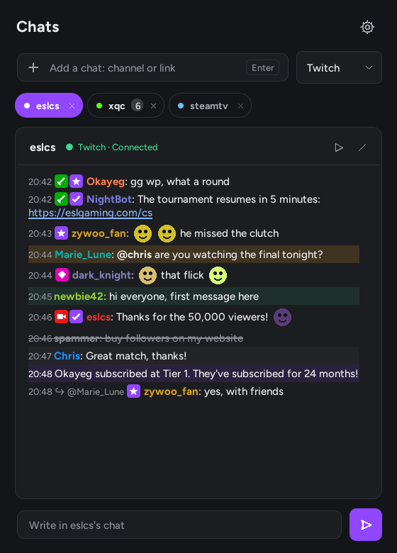
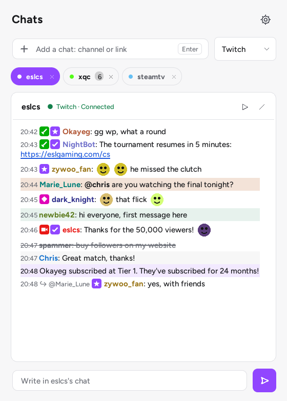
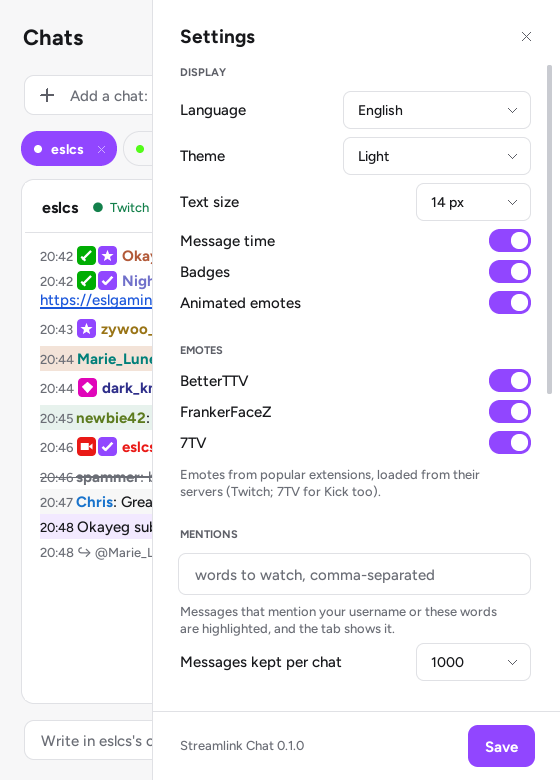
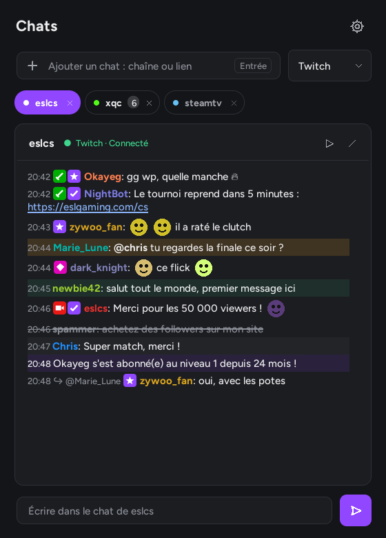
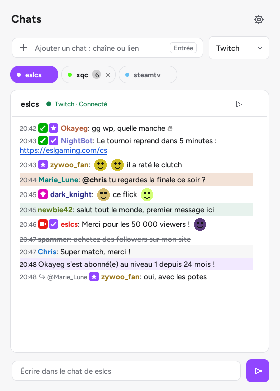
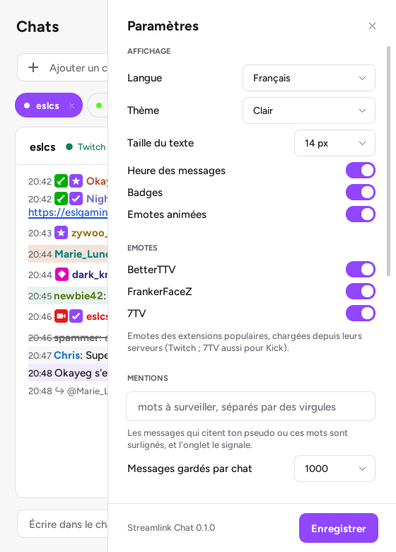

# Streamlink Chat

**[English](#english) · [Français](#français)**

[](https://github.com/Bulls64/Streamlink-Chat/releases/latest) 



---

## English

A lightweight chat client for **Twitch, Kick and Steam TV**, in the spirit of [Chatterino](https://chatterino.com) and in the style of [Streamlink Launcher](https://github.com/Bulls64/Streamlink-Launcher). Read any channel's chat without an account, write once logged in.

Pure Python + Tkinter, **no third-party dependency**.

### Features

- **Tabs**: one tab per chat, any mix of platforms. Type a channel name or paste a link (`twitch.tv/…`, `kick.com/…`, `steam.tv/…`, `steamcommunity.com/broadcast/watch/…`). Tabs come back at the next start; unread messages and mentions show on each tab.
- **Messages**: badges, username colors adjusted to stay readable on the theme, emotes as images (Twitch, plus [BetterTTV](https://betterttv.com), [FrankerFaceZ](https://www.frankerfacez.com) and [7TV](https://7tv.app), animated GIFs included), clickable links, replies, subscriptions and other events, deleted messages and timeouts struck out.
- **Mentions**: messages that mention your username, or words you choose, are highlighted.
- **Comfortable reading**: scrolling up pauses the chat, *New messages* takes you back down; message time, badges, text size and history length can be changed.
- **Writing** (Twitch and Kick): <kbd>Tab</kbd> completes usernames and emotes, <kbd>↑</kbd> recalls your last messages, right-click a username to mention it.
- **Watch**: the ▶ button starts the stream with [Streamlink](https://streamlink.github.io/).
- **Updates**: *Settings › Updates* checks GitHub for a new version (at start-up, or with *Check*) and installs it in one click; an option installs it by itself at start-up.
- **Interface**: light, dark or automatic theme (follows Windows), in English, French, Spanish, German and Italian.

| Light theme | Settings |
|---|---|
|  |  |

### Platforms

| Platform | Reading | Writing | How |
|---|---|---|---|
| Twitch | Without account | After login | IRC over WebSocket (`irc-ws.chat.twitch.tv`) |
| Kick | Without account (**experimental**) | After login | Kick's real-time chat; sending through the official API |
| Steam TV | Without account | — | Steam's internal broadcast web API |

**Kick is experimental.** On 13 October 2026, Kick moved its chat to a new, undocumented real-time system (Centrifugo, negotiated through `web.kick.com`). Streamlink Chat follows what is known of it, with the old Pusher connection as a fallback, and Kick's anti-bot protection can block some requests. If a Kick chat stays in error, please [open an issue](https://github.com/Bulls64/Streamlink-Chat/issues). Steam's broadcast API is not documented either.

### Getting started

#### Windows: executable

Download `StreamlinkChat-<version>.exe` from the [latest release](https://github.com/Bulls64/Streamlink-Chat/releases/latest), put it in a folder of your choice and double-click it. It is not code-signed: if SmartScreen shows *"Windows protected your PC"*, click **More info** then **Run anyway**, after checking its SHA-256 against `SHA256SUMS.txt` (`Get-FileHash .\StreamlinkChat-<version>.exe` in PowerShell).

#### Linux: AppImage

```sh
chmod +x StreamlinkChat-*-x86_64.AppImage
./StreamlinkChat-*-x86_64.AppImage
```

It includes its own Python and Tcl/Tk. It needs glibc 2.35 or newer (Ubuntu 22.04, Debian 12, Fedora 36, Linux Mint 21 or newer). Without FUSE (`libfuse2`), run it with `--appimage-extract-and-run`.

#### From source

Python 3.10 or newer, with Tcl/Tk:

```sh
git clone https://github.com/Bulls64/Streamlink-Chat.git
cd Streamlink-Chat
python slink_chat.py            # pythonw on Windows to hide the console
```

Arguments open chats directly: a channel link, or `--open twitch:channel --open kick:channel`. Starting it again while it is open sends those chats to the open window.

### Writing in chats

Writing needs your own (free) application on each platform, so that no secret is shipped with the program. *Settings › Accounts*:

- **Twitch**: create an application on [dev.twitch.tv](https://dev.twitch.tv/console/apps/create) (category *Chat Bot*, client type **Public**, redirect URL `http://localhost`). Paste its **Client ID**, click *Log in to Twitch*, then enter the code shown on the twitch.tv page that opens.
- **Kick**: create an application in Kick's developer settings (*Settings › Developer*) with the redirect URL `http://localhost:48125/callback` and the *read user info* and *write to chat* scopes. Paste its **Client ID** and **Client Secret**, then authorize it in the page that opens.

Tokens are saved in `chat.json`, encrypted with Windows DPAPI on Windows (in plain text on Linux, in your home folder). *Log out* removes them.

### Updates

*Settings › Updates* shows the installed version and checks the [latest release](https://github.com/Bulls64/Streamlink-Chat/releases/latest): automatically a few seconds after start-up (*Check for updates at start-up*, on by default) or with the *Check* button. When a newer version exists, *Update* downloads the executable, checks it and restarts Streamlink Chat with your open chats. With *Automatic updates* (off by default), this happens by itself at start-up.

- The file must be the release asset of this repository, with the size and the SHA-256 published by GitHub, and look like a Windows executable. Redirects are followed only to GitHub. If the current executable is signed, the new one must be signed by the same publisher.
- The previous executable is renamed `.old` and removed at the next start; on any failure, it is put back. A file named after its version (`StreamlinkChat-0.1.0.exe`) takes the new number.
- Installing by itself only works for the Windows `.exe` in a folder you can write to. From the sources or with the AppImage, *Update* opens the release page instead.

### Keyboard

| Action | Keys |
|---|---|
| Add a chat | <kbd>Ctrl</kbd>+<kbd>T</kbd>, then a name or link and <kbd>Enter</kbd> |
| Next / previous chat | <kbd>Ctrl</kbd>+<kbd>Tab</kbd> / <kbd>Ctrl</kbd>+<kbd>Shift</kbd>+<kbd>Tab</kbd> |
| Close the chat | <kbd>Ctrl</kbd>+<kbd>W</kbd> (or middle-click its tab) |
| Send / recall | <kbd>Enter</kbd> / <kbd>↑</kbd> <kbd>↓</kbd> |
| Complete a username or emote | <kbd>Tab</kbd> |

### Configuration and data

Files are stored next to `slink_chat.py` or the `.exe`; if that folder is read-only, in `%APPDATA%\Streamlink Chat` (Windows) or `~/.config/streamlink-chat` (Linux, always for the AppImage).

| File | Content |
|---|---|
| `chat.json` | Open chats, settings, accounts |
| `cache/emotes/` | Downloaded emote images |
| `chat.log` | Error log, useful when reporting a problem |

### Network and privacy

Streamlink Chat connects only to: the chats themselves (Twitch IRC, Kick at `kick.com` / `web.kick.com` and its real-time server, Steam at `steamcommunity.com`); emote lists and images from Twitch, BetterTTV, FrankerFaceZ and 7TV (each can be turned off); `api.github.com` to check for a new version (can be turned off), and `github.com` to download it; and, for writing, the official Twitch and Kick login and chat APIs. Nothing else is sent.

### Building

- **Windows executable**: `packaging\build_exe.bat` (PyInstaller, version pinned in `packaging/requirements-build.txt`) produces `dist\Streamlink Chat.exe`.
- **AppImage**: `bash packaging/appimage/build_appimage.sh` (needs `build-essential libx11-dev libxft-dev libxss-dev libfontconfig-dev patchelf`); it bundles a standalone Python and recompiles Tcl/Tk with Xft for smooth text.
- On GitHub Actions, every pull request builds both, and pushing a `v*` tag publishes them with `SHA256SUMS.txt`.

### Tests

```sh
python -m unittest discover -s tests -v
```

The protocol tests run against local fake Twitch, Kick and Steam servers (no Internet needed). They run on Windows and Linux at every push, with `ruff` and a GUI smoke test.

### Credits

Inspired by [Chatterino](https://chatterino.com). Emotes from [BetterTTV](https://betterttv.com), [FrankerFaceZ](https://www.frankerfacez.com) and [7TV](https://7tv.app). The interface components come from [Streamlink Launcher](https://github.com/Bulls64/Streamlink-Launcher). MIT license.

---

## Français

Un client de chat léger pour **Twitch, Kick et Steam TV**, dans l'esprit de [Chatterino](https://chatterino.com) et dans le style de [Streamlink Launcher](https://github.com/Bulls64/Streamlink-Launcher). Lis le chat de n'importe quelle chaîne sans compte, écris une fois connecté.

Python et Tkinter uniquement, **sans aucune dépendance externe**.



### Fonctionnalités

- **Onglets** : un onglet par chat, toutes plateformes mélangées. Tape un nom de chaîne ou colle un lien (`twitch.tv/…`, `kick.com/…`, `steam.tv/…`, `steamcommunity.com/broadcast/watch/…`). Les onglets reviennent au démarrage suivant ; messages non lus et mentions s'affichent sur chaque onglet.
- **Messages** : badges, couleurs des pseudos ajustées pour rester lisibles sur le thème, emotes en images (Twitch, plus [BetterTTV](https://betterttv.com), [FrankerFaceZ](https://www.frankerfacez.com) et [7TV](https://7tv.app), GIF animés compris), liens cliquables, réponses, abonnements et autres événements, messages supprimés et exclusions barrés.
- **Mentions** : les messages qui citent ton pseudo, ou les mots de ton choix, sont surlignés.
- **Lecture confortable** : remonter dans le chat met le défilement en pause, *Nouveaux messages* ramène en bas ; heure des messages, badges, taille du texte et longueur de l'historique réglables.
- **Écriture** (Twitch et Kick) : <kbd>Tab</kbd> complète pseudos et emotes, <kbd>↑</kbd> rappelle tes derniers messages, clic droit sur un pseudo pour le mentionner.
- **Regarder** : le bouton ▶ lance le stream avec [Streamlink](https://streamlink.github.io/).
- **Mises à jour** : *Paramètres › Mises à jour* cherche une nouvelle version sur GitHub (au démarrage, ou avec *Vérifier*) et l'installe en un clic ; une option l'installe toute seule au démarrage.
- **Interface** : thème clair, sombre ou automatique (suit Windows), en français, anglais, espagnol, allemand et italien.

| Thème clair | Paramètres |
|---|---|
|  |  |

### Plateformes

| Plateforme | Lecture | Écriture | Comment |
|---|---|---|---|
| Twitch | Sans compte | Après connexion | IRC sur WebSocket (`irc-ws.chat.twitch.tv`) |
| Kick | Sans compte (**expérimental**) | Après connexion | Chat temps réel de Kick ; envoi par l'API officielle |
| Steam TV | Sans compte | — | API web interne des diffusions Steam |

**Kick est expérimental.** Le 13 octobre 2026, Kick a basculé son chat sur un nouveau système temps réel non documenté (Centrifugo, négocié via `web.kick.com`). Streamlink Chat suit ce qu'on en sait, avec l'ancienne connexion Pusher en secours, et la protection anti-robots de Kick peut bloquer certaines requêtes. Si un chat Kick reste en erreur, [ouvre un ticket](https://github.com/Bulls64/Streamlink-Chat/issues). L'API des diffusions Steam n'est pas documentée non plus.

### Démarrage

#### Windows : l'exécutable

Télécharge `StreamlinkChat-<version>.exe` depuis la [dernière release](https://github.com/Bulls64/Streamlink-Chat/releases/latest), place-le dans le dossier de ton choix et double-clique dessus. Il n'est pas signé : si SmartScreen affiche *« Windows a protégé votre ordinateur »*, clique sur **Informations complémentaires** puis **Exécuter quand même**, après avoir comparé son SHA-256 avec `SHA256SUMS.txt` (`Get-FileHash .\StreamlinkChat-<version>.exe` dans PowerShell).

#### Linux : l'AppImage

```sh
chmod +x StreamlinkChat-*-x86_64.AppImage
./StreamlinkChat-*-x86_64.AppImage
```

Elle embarque son propre Python et Tcl/Tk. Il faut la glibc 2.35 ou plus récente (Ubuntu 22.04, Debian 12, Fedora 36, Linux Mint 21 ou plus récents). Sans FUSE (`libfuse2`), lance-la avec `--appimage-extract-and-run`.

#### Depuis les sources

Python 3.10 ou plus récent, avec Tcl/Tk :

```sh
git clone https://github.com/Bulls64/Streamlink-Chat.git
cd Streamlink-Chat
python slink_chat.py            # pythonw sous Windows pour masquer la console
```

Des arguments ouvrent des chats directement : un lien de chaîne, ou `--open twitch:chaîne --open kick:chaîne`. Relancer le programme alors qu'il est ouvert envoie ces chats à la fenêtre déjà ouverte.

### Écrire dans les chats

Écrire demande ta propre application (gratuite) sur chaque plateforme, pour qu'aucun secret ne soit livré avec le programme. *Paramètres › Comptes* :

- **Twitch** : crée une application sur [dev.twitch.tv](https://dev.twitch.tv/console/apps/create) (catégorie *Chat Bot*, type de client **Public**, URL de redirection `http://localhost`). Colle son **Client ID**, clique sur *Se connecter à Twitch*, puis saisis le code affiché dans la page twitch.tv qui s'ouvre.
- **Kick** : crée une application dans les paramètres développeur de Kick (*Paramètres › Développeur*) avec l'URL de redirection `http://localhost:48125/callback` et les autorisations *lire les infos* et *écrire dans le chat*. Colle son **Client ID** et son **Client Secret**, puis autorise-la dans la page qui s'ouvre.

Les jetons sont enregistrés dans `chat.json`, chiffrés par DPAPI sous Windows (en clair sous Linux, dans ton dossier personnel). *Se déconnecter* les efface.

### Mises à jour

*Paramètres › Mises à jour* affiche la version installée et consulte la [dernière release](https://github.com/Bulls64/Streamlink-Chat/releases/latest) : automatiquement quelques secondes après le démarrage (*Vérifier les mises à jour au démarrage*, activé par défaut) ou avec le bouton *Vérifier*. Si une version plus récente existe, *Mettre à jour* télécharge l'exécutable, le contrôle et redémarre Streamlink Chat avec tes chats ouverts. Avec *Mises à jour automatiques* (désactivé par défaut), tout se fait seul au démarrage.

- Le fichier doit être celui de la release de ce dépôt, avec la taille et l'empreinte SHA-256 publiées par GitHub, et ressembler à un exécutable Windows. Les redirections ne sont suivies que vers GitHub. Si l'exécutable actuel est signé, le nouveau doit l'être par le même éditeur.
- L'ancien exécutable est renommé `.old` et supprimé au démarrage suivant ; en cas d'échec, il est remis en place. Un fichier nommé d'après sa version (`StreamlinkChat-0.1.0.exe`) prend le nouveau numéro.
- L'installation automatique ne concerne que l'`.exe` Windows placé dans un dossier modifiable. Depuis les sources ou avec l'AppImage, *Mettre à jour* ouvre la page de la release.

### Clavier

| Action | Touches |
|---|---|
| Ajouter un chat | <kbd>Ctrl</kbd>+<kbd>T</kbd>, puis un nom ou un lien et <kbd>Entrée</kbd> |
| Chat suivant / précédent | <kbd>Ctrl</kbd>+<kbd>Tab</kbd> / <kbd>Ctrl</kbd>+<kbd>Maj</kbd>+<kbd>Tab</kbd> |
| Fermer le chat | <kbd>Ctrl</kbd>+<kbd>W</kbd> (ou clic du milieu sur l'onglet) |
| Envoyer / rappeler | <kbd>Entrée</kbd> / <kbd>↑</kbd> <kbd>↓</kbd> |
| Compléter un pseudo ou une emote | <kbd>Tab</kbd> |

### Configuration et données

Les fichiers sont rangés à côté de `slink_chat.py` ou du `.exe` ; si ce dossier est protégé en écriture, dans `%APPDATA%\Streamlink Chat` (Windows) ou `~/.config/streamlink-chat` (Linux, toujours pour l'AppImage).

| Fichier | Contenu |
|---|---|
| `chat.json` | Chats ouverts, réglages, comptes |
| `cache/emotes/` | Images d'emotes téléchargées |
| `chat.log` | Journal des erreurs, utile pour signaler un problème |

### Réseau et vie privée

Streamlink Chat ne se connecte qu'aux chats eux-mêmes (IRC Twitch, Kick via `kick.com` / `web.kick.com` et son serveur temps réel, Steam via `steamcommunity.com`), aux listes et images d'emotes de Twitch, BetterTTV, FrankerFaceZ et 7TV (chacun désactivable), à `api.github.com` pour chercher une nouvelle version (désactivable) et à `github.com` pour la télécharger, et, pour écrire, aux API officielles de connexion et de chat de Twitch et Kick. Rien d'autre n'est envoyé.

### Compilation

- **Exécutable Windows** : `packaging\build_exe.bat` (PyInstaller, version figée dans `packaging/requirements-build.txt`) produit `dist\Streamlink Chat.exe`.
- **AppImage** : `bash packaging/appimage/build_appimage.sh` (paquets `build-essential libx11-dev libxft-dev libxss-dev libfontconfig-dev patchelf`) ; elle embarque un Python autonome et recompile Tcl/Tk avec Xft pour un texte lissé.
- Sur GitHub Actions, chaque pull request construit les deux, et pousser un tag `v*` les publie avec `SHA256SUMS.txt`.

### Tests

```sh
python -m unittest discover -s tests -v
```

Les tests des protocoles tournent contre de faux serveurs Twitch, Kick et Steam locaux (pas besoin d'Internet). Ils tournent sous Windows et Linux à chaque push, avec `ruff` et un test de fumée de l'interface.

### Crédits

Inspiré de [Chatterino](https://chatterino.com). Emotes de [BetterTTV](https://betterttv.com), [FrankerFaceZ](https://www.frankerfacez.com) et [7TV](https://7tv.app). Les composants d'interface viennent de [Streamlink Launcher](https://github.com/Bulls64/Streamlink-Launcher). Licence MIT.
